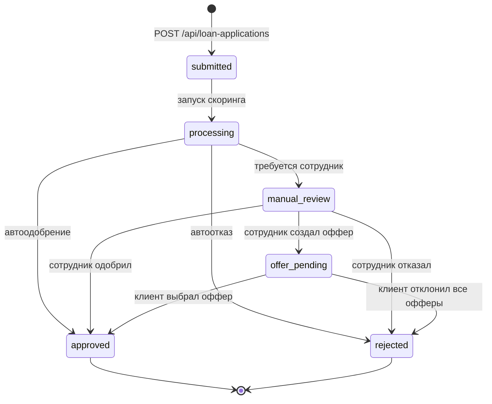

# Диаграмма состояний заявки

Статус хранится в `loan_applications.application_status`.

| Переход | Инициатор | Условие / API |
|---|---|---|
| `submitted → processing` | backend | создание заявки и вызов скоринга |
| `processing → approved` | backend | продукт прошёл проверки и автоодобрение |
| `processing → rejected` | backend | продукт не прошёл обязательные проверки |
| `processing → manual_review` | backend | низкий рейтинг, цель «Другое», ошибка или иное правило |
| `manual_review → approved` | сотрудник | `POST /decision`, `decision=approved` + сумма/срок |
| `manual_review → rejected` | сотрудник | `POST /decision`, `decision=rejected` |
| `manual_review → offer_pending` | сотрудник | `POST /employee-offer` |
| `offer_pending → approved` | предприниматель | `POST /offers/{offer_id}/select` |
| `offer_pending → rejected` | предприниматель | `POST /offers/{offer_id}/decline` (нет активных офферов) |

`approved` и `rejected` — терминальные статусы; повторная обработка оффера
возвращает `409`. Статусы офферов (`offered`, `selected`, `declined`,
`superseded`) описаны в `src/db/README.md`.
