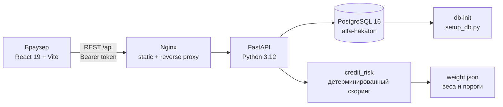

# Архитектура

## Контекст

Решение автоматизирует кредитный конвейер ИП/ООО: подбор продукта, скоринг,
подачу заявки, автоматическое или ручное решение, индивидуальные предложения
сотрудника и выбор предложения предпринимателем.

## Компоненты и связи

| Компонент | Ответственность |
|---|---|
| `src/front` | SPA предпринимателя и сотрудника банка; токен в `sessionStorage`, вызовы `/api` |
| `src/backend` | REST API, авторизация, скоринг, маршрутизация заявок, ручные решения, офферы |
| `src/credit_risk` | расчёт рейтинга 0–1000 по методике и `weight.json` |
| `src/db` | схема, demo-данные, загрузчики, bootstrap для Docker |
| PostgreSQL | хранение компаний, отчётности, продуктов, заявок, офферов, решений, истории |
| Nginx | production-раздача SPA и proxy `/api` → backend |

## Потоки

1. Предприниматель входит через `POST /api/auth/login`; backend проверяет
   `login` и выдаёт HMAC-подписанный Bearer-токен (TTL 12 ч).
2. При создании заявки backend вызывает `credit_risk`, сохраняет скоринг и
   проверки, затем маршрутизирует заявку: автоматическое решение, отказ или
   `manual_review`.
3. Сотрудник работает с очередью `manual_review`: одобряет, отклоняет или
   создаёт `application_offers` с собственными суммой/сроком.
4. Предприниматель принимает или отклоняет оффер; итоговое решение и история
   фиксируются в БД.

## Развёртывание

`docker compose up --build -d` поднимает `db`, one-shot `db-init`, `backend` и
`frontend` (Nginx). Состояние БД сохраняется в volume `postgres_data`.
