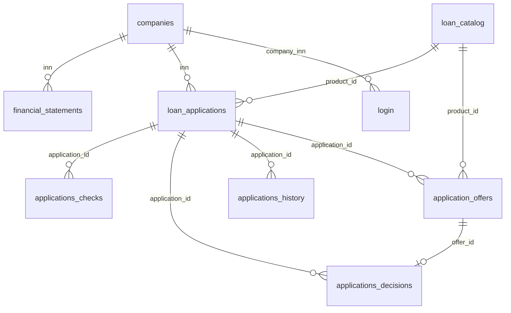

# Модель данных

Источник истины — DDL [`src/db/DB.sql`](../src/db/DB.sql); подробное описание
полей, ограничений и инвариантов — [`src/db/README.md`](../src/db/README.md).

## Сущности

| Таблица | Назначение | Ключевые поля |
|---|---|---|
| `companies` | заёмщики | `inn` PK, `company_status`, `industry` |
| `financial_statements` | годовая отчётность | `financial_id` PK, `inn` FK, `report_year` |
| `loan_catalog` | кредитные продукты | `product_id` PK, лимиты, ставка, `min_credit_rating` |
| `loan_applications` | заявки | `application_id` PK, `inn`, `product_id`, `application_status` |
| `applications_checks` | результаты проверок/скоринга | `check_id` PK, `application_id`, `product_id`, `scoring` |
| `application_offers` | автоматические и ручные офферы | `offer_id` PK, `offer_source`, `offer_status`, `created_by` |
| `applications_decisions` | итоговые решения | `decision_id` PK, `offer_id`, `decision_source`, `decided_by` |
| `applications_history` | аудит событий | `history_id` PK, `event_type`, `actor_username` |
| `login` | локальные учётные записи | `username` PK, `profile_type`, `company_inn` |

Связи и ограничения целостности (включая уникальность одного `selected`
оффера на заявку) описаны в `src/db/README.md`.
